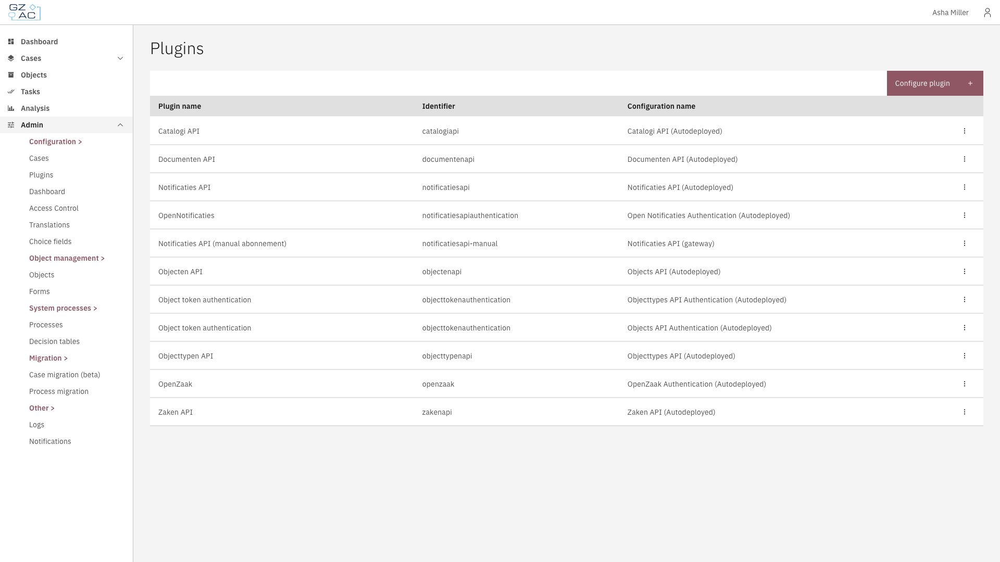
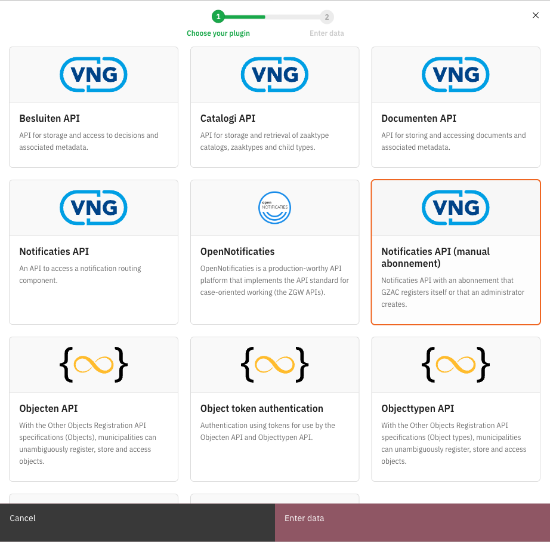
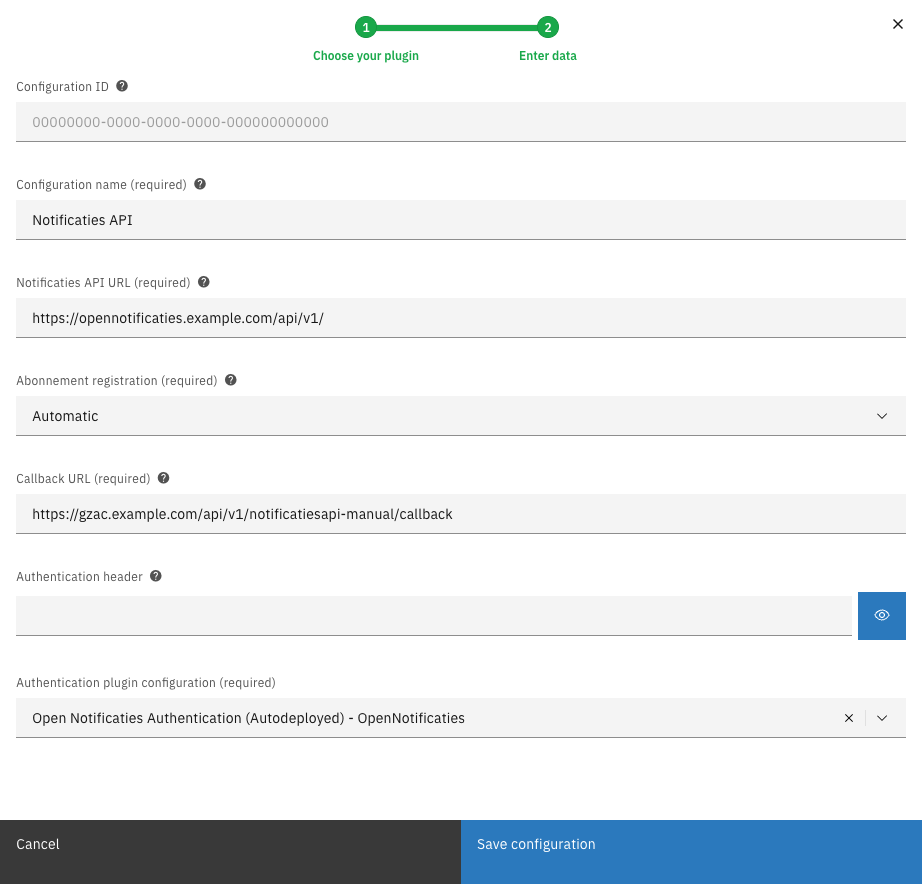
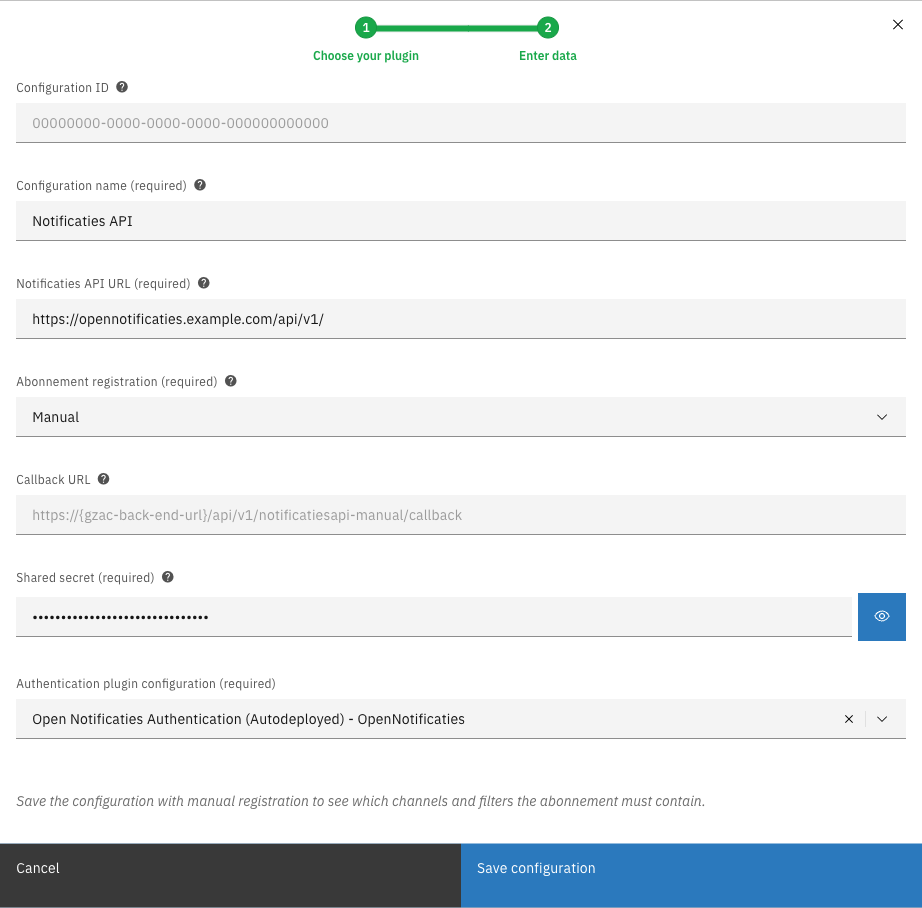
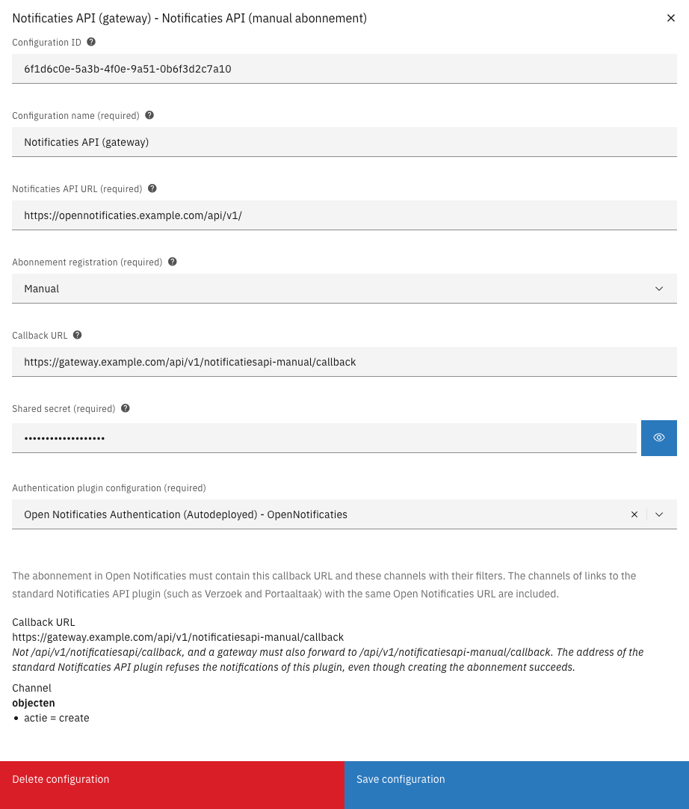

# 🔌 Notificaties API (manual abonnement)


For Valtimo `13.41.0` and later 13.x versions. The Notificaties API (manual abonnement) is a ZGW plugin and can only be
used in the GZAC edition. From Valtimo `13.52.0`, the standard Notificaties API plugin offers manual abonnement
registration itself; see [Moving to the standard plugin](#moving-to-the-standard-plugin).


The Notificaties API (manual abonnement) plugin connects Valtimo to Open Notificaties, like the standard Notificaties
API plugin, and adds one option: an administrator can create the abonnement (subscription) in Open Notificaties
instead of Valtimo.

Use this option when all traffic between systems goes through a gateway that checks certificates. When Valtimo
registers an abonnement itself, Open Notificaties first sends a test message to Valtimo. Such a gateway refuses that
message, so the registration fails.

The plugin works next to the standard Notificaties API plugin and changes nothing for it. Notificaties it receives are
processed exactly like those of the standard plugin: **Verzoek**, **Portaaltaak** and **Receive a notification**
process links all receive them. A notificatie that arrives through both plugins is processed once.

Each plugin configuration chooses how its abonnement is registered:

| Abonnement registration | Who creates the abonnement | When to use |
|-------------------------|----------------------------|-------------|
| **Automatic** | Valtimo creates, updates and removes the abonnement and the channels it needs, shortly after the configuration is saved. | Open Notificaties can reach Valtimo directly. |
| **Manual** | An administrator creates the abonnement in Open Notificaties. Valtimo creates, changes and removes nothing in Open Notificaties for this configuration. | Traffic goes through a gateway that checks certificates. |


A developer adds the plugin to the application first. See [Installation and technical details](technical-details.md).


---

## Configuring the plugin



Go to **Admin** > **Plugins**

<figure><figcaption>Plugins overview</figcaption></figure>


Click **Configure plugin**, select **Notificaties API (manual abonnement)** and click **Enter data**

<figure><figcaption>Choosing the plugin</figcaption></figure>


Fill in the properties and click **Save configuration**

<figure><figcaption>Configuration with automatic registration</figcaption></figure>



| Property | Description |
|----------|-------------|
| Configuration ID | Optional; leave it empty to have one generated. |
| Configuration name | The name under which the configuration can be found in the rest of the application. |
| Notificaties API URL | The address of Open Notificaties, for example `https://opennotificaties.example.com/api/v1/`. |
| Abonnement registration | **Automatic** (the default) or **Manual**. |
| Callback URL | The address where Open Notificaties sends notificaties: the address through which Open Notificaties reaches Valtimo, followed by `/api/v1/notificatiesapi-manual/callback`. Required with **Automatic**. Optional with **Manual**, where it is usually the address of the gateway: Valtimo only shows it with the abonnement. |
| Authentication header | Shown with **Automatic**. The secret that Valtimo places on the abonnement it registers. When left empty, the secret of the existing abonnement stays in use, or a random one is generated. |
| Shared secret | Shown with **Manual**, and required. The secret that the administrator also enters on the abonnement in Open Notificaties. |
| Authentication plugin configuration | A configuration of the **OpenNotificaties** authentication plugin, which Valtimo uses to connect to Open Notificaties. |

Saving shows a general error message when:

- the shared secret starts with the word `Bearer`, or contains special characters such as accented letters;
- the callback URL is the address of the standard Notificaties API plugin (ending in `/api/v1/notificatiesapi/callback`),
  or the callback URL of one of its configurations.

Dutch labels

| English | Dutch |
|---------|-------|
| Notificaties API (manual abonnement) | Notificaties API (handmatig abonnement) |
| Configure plugin | Plugin configureren |
| Enter data | Gegevens invullen |
| Save configuration | Configuratie opslaan |
| Abonnement registration | Registratie abonnement |
| Automatic / Manual | Automatisch / Handmatig |
| Authentication header | Authenticatie header |
| Shared secret | Gedeeld geheim |
| Authentication plugin configuration | Configuratie authenticatie-plug-in |

---

## Registering the abonnement manually

### Setting the configuration to Manual



Open a new or existing configuration of this plugin


Select **Manual** in **Abonnement registration**


Optionally enter the **Callback URL**: the address through which Open Notificaties reaches Valtimo via the gateway,
followed by `/api/v1/notificatiesapi-manual/callback`. Valtimo doesn't use it; it only shows it with the abonnement.


Enter a **Shared secret**: a long, random value of letters and digits


Click **Save configuration**



An example configuration with manual registration:

<figure><figcaption>Configuration with manual registration</figcaption></figure>

### Viewing what the abonnement must contain

After a configuration is saved with **Manual**, its form shows what the abonnement in Open Notificaties must contain:
the callback URL (or, when none was entered, how it is made up), and every channel with its filters. For a new
configuration the form asks to save it first.

<figure><figcaption>What the abonnement must contain</figcaption></figure>

The list contains the channels and filters of:

- **Receive a notification** process links that use this configuration;
- **Receive a notification** process links of the standard Notificaties API plugin that connect to the same Open
  Notificaties;
- other plugins that use a standard Notificaties API configuration connecting to the same Open Notificaties, such as
  **Verzoek** and **Portaaltaak**.

Those other plugins can only be linked to the standard Notificaties API plugin. Behind the gateway their notificaties
arrive through the abonnement of this plugin, which is why they are listed here.

If nothing needs a channel yet, the form says so; the abonnement then only needs the callback URL and the shared
secret. The list changes when such a process link or plugin configuration is added, changed or removed. Update the
abonnement in Open Notificaties to match.

### Creating the abonnement in Open Notificaties

In the admin of Open Notificaties:



Make sure every channel in the list exists. Create a missing channel under **Kanalen**.


Create an abonnement with the callback URL: the address through which Open Notificaties reaches Valtimo via the
gateway, followed by `/api/v1/notificatiesapi-manual/callback`


Enter the **Shared secret** of the configuration in the **Auth** field of the abonnement


Add every channel in the list, with exactly the filters shown for it. A line such as `actie = create` becomes a filter
with key `actie` and value `create`.




Don't use `/api/v1/notificatiesapi/callback`, the address of the standard Notificaties API plugin, in the abonnement
or as the target of the gateway route. Creating the abonnement still succeeds, but the standard plugin refuses every
notificatie with the shared secret of this plugin, so none is processed. Open Notificaties stops retrying after a few
attempts, and those notificaties are lost.


### Notificaties on the wrong address

When a notificatie with the shared secret of a **Manual** configuration arrives on
`/api/v1/notificatiesapi/callback`, the form of that configuration shows the warning **Notifications arrive at the
wrong address**, with the time of the last one. Valtimo also logs a warning. This also happens for the test notificatie
that Open Notificaties sends when the abonnement is created.

Change the callback URL of the abonnement in Open Notificaties, or the route in the gateway, to
`/api/v1/notificatiesapi-manual/callback`. The warning disappears as soon as a notificatie with the shared secret
arrives on that address. Notificaties that were refused before are not delivered again.

Valtimo only processes notificaties that carry the shared secret of this plugin. Other notificaties are refused.

---

## Process actions

The plugin offers the same actions as the standard Notificaties API plugin:

| Action | Description |
|--------|-------------|
| **Publish a notification** | Publishes a notificatie in Open Notificaties. |
| **Receive a notification** | Lets a process wait until a matching notificatie arrives. All filters are optional. |

**Receive a notification** process links in building blocks don't work, neither with this plugin nor with the standard
plugin.

---

## Things to keep in mind


**Switching a configuration to Manual.** The abonnement that Valtimo registered earlier stays in Open Notificaties and
keeps sending notificaties until an administrator removes it there. If an **Authentication header** was filled in, the
**Shared secret** field takes it over. Keep it to go on accepting the old abonnement's notificaties, or change it to
refuse them. Remove the old abonnement in Open Notificaties.



**A notificatie can arrive twice.** When processing a notificatie fails somewhere, Valtimo tries again for every
process and plugin that receives it. Processes that react to notificaties must be able to handle the same notificatie
twice.



**Deleting a configuration** does not remove a manually created abonnement from Open Notificaties. Remove it there.
The same applies to an abonnement that Valtimo registered when the **Notificaties API URL** of a configuration is
changed: the old abonnement stays in the old Open Notificaties.



The shared secret is included as readable text when plugin configurations are exported.


---

## Moving to the standard plugin

From Valtimo `13.52.0` the standard Notificaties API plugin has manual abonnement registration itself. To move:



Create a configuration of the standard Notificaties API plugin with **Abonnement registration** set to **Manual** and
the same shared secret


In Open Notificaties, change the callback URL of the abonnement to the one shown in the configuration of the standard
plugin (ending in `/api/v1/notificatiesapi/callback`)


Link the **Publish a notification** and **Receive a notification** process links to the new configuration


Delete the configuration of this plugin, then ask a developer to remove the plugin from the application


